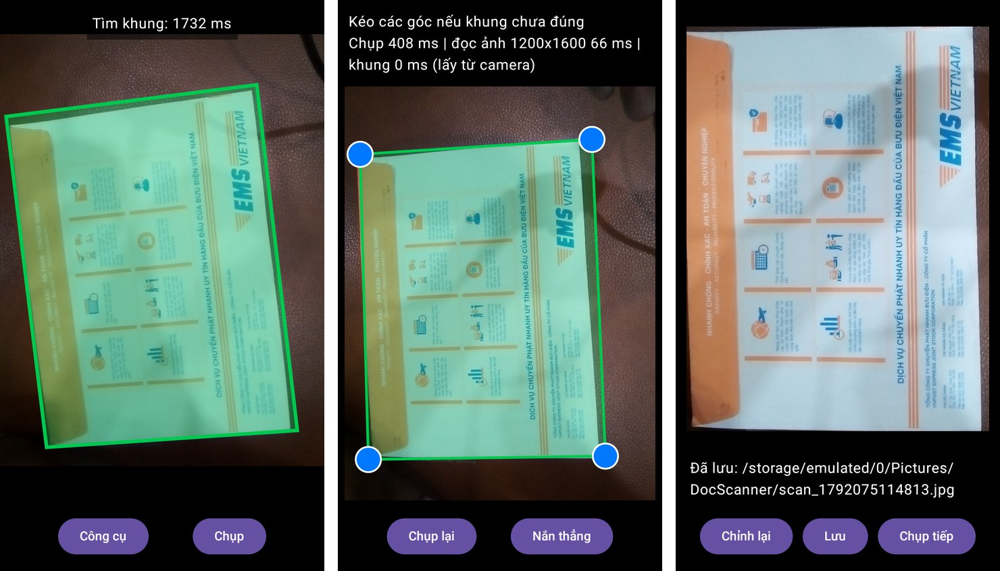

# doc-scanner-mlsd

App scan tài liệu **chạy offline hoàn toàn trên Android**: mở camera, tự tìm 4 góc tờ giấy theo thời gian thực bằng model M-LSD (phát hiện đoạn thẳng), chụp, chỉnh góc, nắn thẳng và lưu ảnh. Trọng tâm kỹ thuật là **đưa model lên điện thoại cấu hình yếu**: viết lại post-processing bằng Kotlin khớp tuyệt đối với bản Python, **tìm và sửa lỗi quantization INT8** làm model gần như hỏng, và đo FP32 / FP16 / INT8 trên CPU / GPU của một chiếc điện thoại thật (Vsmart Bee 3: 4 nhân Cortex-A53 32-bit, RAM 2 GB, Android 9).



*Chụp màn hình app trên Vsmart Bee 3, từ trái qua phải: (1) camera tự tìm tờ giấy và vẽ khung xanh, model INT8 chạy ngay trên máy; (2) sau khi chụp, kéo 4 góc nếu khung chưa đúng; (3) ảnh đã nắn thẳng và lưu vào máy.*

Dự án cá nhân, nối tiếp phần luyện tập quantization ở repo [Quantization](https://github.com/TruongDuke/Quantization).

## Điểm nổi bật

- **Sửa quantization INT8 của M-LSD.** Bản INT8 mặc định gần như hỏng: không tìm được tờ giấy ở 66/120 khung hình thử. Đã chỉ ra nguyên nhân bằng mô phỏng (các kênh output dùng chung một scale, và giá trị ngoại lai tới ±1100 ở vùng không có đoạn thẳng làm scale quá thô), rồi sửa model thật: tách output head, cắt ngoại lai trước khi quantize, calibration bằng ảnh tài liệu. IoU tăng từ **0.395 lên 0.751** (bản FP32: 0.802).
- **Chạy nhanh hơn 1.7 lần trên máy yếu.** Trên Bee 3, INT8 đã sửa chạy **1.18 s/ảnh** so với FP32 1.99 s (CPU, 4 luồng). Đã so cả GPU (PowerVR GE8100): GPU chỉ có lợi cho FP32/FP16 (~1.4 lần) nhưng mất 23-30 s để khởi tạo, còn INT8 trên GPU chậm hơn CPU.
- **Post-processing viết lại bằng Kotlin, khớp tuyệt đối với Python.** `pred_lines`, `pred_squares` của repo gốc và `cv2.resize(INTER_AREA)` của OpenCV được port sang Kotlin, kiểm tra bằng golden test sinh từ bản Python: khớp 6/6 ảnh ở mọi bước (đầu vào model, output model, đoạn thẳng, tứ giác), cả trên máy tính, máy ảo và điện thoại thật.
- **Đánh giá trên dữ liệu tài liệu thật.** Dùng bộ SmartDoc 2015 (24.889 khung hình, 30 tài liệu, 5 nền), chia tập calibration / đánh giá **theo tài liệu** để tránh rò rỉ dữ liệu giữa các khung hình gần giống nhau. Chỉnh trọng số chấm điểm tứ giác cho tài liệu: tỉ lệ khung tìm đúng (IoU ≥ 0.9) trên tập dùng để chỉnh tăng từ 52% lên 74%.
- **App hoàn chỉnh**: CameraX (khung xanh trực tiếp), chụp, kéo 4 góc, nắn thẳng phối cảnh, lưu vào thư viện ảnh; màn hình "Công cụ" có kiểm tra golden và đo tốc độ ngay trên máy.

## Cách hoạt động

```
Camera (CameraX) ─► ảnh RGB ─► resize 512x512 (INTER_AREA, Kotlin)
   ─► M-LSD tiny INT8 (LiteRT) ─► bản đồ center + displacement 256x256
   ─► pred_lines: lấy top 200 điểm, dựng đoạn thẳng
   ─► pred_squares: gộp đoạn, tìm giao điểm, ghép và chấm điểm tứ giác
   ─► tứ giác tốt nhất = 4 góc tờ giấy ─► chỉnh tay ─► nắn thẳng ─► lưu
```

## Kết quả

### Quantization (120 khung SmartDoc, 12 tài liệu không dùng khi calibration)

| Model | IoU trung bình | Khung đúng (IoU ≥ 0.9) | Thời gian (Mac, 4 luồng) |
|---|---|---|---|
| FP32 (lhwcv, convert lại) | 0.802 | 55.0% | 33 ms |
| INT8 mặc định | 0.395 | 36.7% | 10 ms |
| INT8 + tách output head | 0.734 | 44.2% | |
| **INT8 + tách head + cắt ngoại lai** | **0.751** | **51.7%** | **9.7 ms** |
| INT8 + giữ head ở float | 0.755 | 51.7% | 10.5 ms |

Model NAVER chính thức chỉ có file `.tflite`, không có mã nguồn, nên model INT8 được tạo lại từ bản PyTorch (lhwcv), convert với đầu vào / đầu ra giống hệt bản NAVER.

### Kỹ thuật quantization đã dùng

**Kiểu quantize:** post-training static quantization, trọng số và activation đều INT8 (`ai_edge_quantizer`, recipe `static_wi8_ai8`), không train lại. Calibration bằng 360 khung SmartDoc của 18 tài liệu, tách hẳn khỏi 12 tài liệu dùng để đánh giá ([tools/make_doc_split.py](tools/make_doc_split.py)).

**1. Tìm chỗ hỏng bằng mô phỏng** ([tools/sim_quant_head.py](tools/sim_quant_head.py)). Giữ toàn bộ model ở FP32, chỉ mô phỏng làm tròn INT8 tại tensor output cuối (256x256x16). Chỉ riêng việc này đã tái hiện đúng lỗi: IoU về 0, chỉ còn 1.8% đoạn thẳng. Vậy lỗi nằm ở output head, không phải ở backbone. Có hai nguyên nhân:
- **Dùng chung một scale.** INT8 per-tensor chỉ có 256 mức cho cả tensor. Tensor cuối gộp cả kênh *center* (logit "có tâm đoạn thẳng không", cần độ mịn quanh ngưỡng) và 4 kênh *displacement* (khoảng cách tới 2 đầu đoạn, giá trị lớn). Kênh lớn quyết định scale, kênh nhỏ bị làm tròn mất.
- **Giá trị ngoại lai.** Ở chỗ không có đoạn thẳng, displacement lên tới ±1100 (tại các điểm thực sự được dùng chỉ ±111) và logit center xuống -47 (điểm được giữ chỉ từ -2.75). Calibration min/max lấy cả các giá trị rác này, nên mỗi mức INT8 ứng với khoảng 8.5 ô lưới, đầu đoạn thẳng lệch lung tung.

Mô phỏng cũng cho thấy phải sửa **cả hai**: chỉ cắt ngoại lai được IoU 0.691, chỉ dùng scale riêng từng kênh được 0.705, làm cả hai được 0.776 (FP32: 0.786).

**2. Sửa trên model thật** ([tools/quantize_lhwcv.py](tools/quantize_lhwcv.py)):
- **Tách output head thành 2 nhánh.** Conv 1x1 cuối (16 kênh ra, chỉ 5 kênh được dùng) được thay bằng 2 conv riêng: một cho center (1 kênh), một cho displacement (4 kênh), chép nguyên trọng số tương ứng. Kết quả FP32 giữ nguyên từng số, nhưng khi quantize mỗi nhánh là một tensor riêng nên có scale riêng. 11 kênh thừa cũng bị bỏ. Phải tách vì LiteRT chỉ cho scale riêng từng kênh với trọng số; activation (output của layer) luôn dùng một scale cho cả tensor.
- **Cắt ngoại lai ngay trong đồ thị.** Thêm `clamp` sau 2 nhánh: logit center ≥ -8 (sigmoid(-8) ≈ 0.0003, xa ngưỡng giữ điểm), displacement trong ±128. Vì phép cắt nằm trong model, calibration chỉ thấy khoảng giá trị có ích nên scale mịn hơn khoảng 8 lần. Phép cắt chỉ chạm vào giá trị rác nên kết quả FP32 không đổi.
- **Thử giữ một số layer ở float** (mixed precision): 3 layer đầu được thí nghiệm trước cho là nhạy nhất, rồi thêm cả head. Chỉ tăng IoU thêm tối đa 0.004 mà chậm hơn, nên bản dùng trong app (V3) là INT8 toàn bộ.

**3. Đưa vào app.** Model sau quantize có đầu vào / đầu ra kiểu int8 (ví dụ đầu vào scale 0.988, zero point -128). App tự đổi ảnh sang int8 và đổi kết quả về số thực theo scale / zero point đọc từ model, nên cùng một code chạy được cả bản FP32 lẫn INT8.

### Tốc độ trên điện thoại thật (Vsmart Bee 3, trung vị 5 lần)

| Model | CPU (XNNPACK) | GPU (PowerVR GE8100) | Khởi tạo GPU |
|---|---|---|---|
| FP32 | 1987 ms | 1418 ms | 23 s |
| FP16 | 1986 ms | 1423 ms | 23 s |
| **INT8 đã sửa** | **1177 ms** | 1993 ms | 30 s |

INT8 trên máy này chỉ nhanh ~1.7 lần (trên Mac 3.4 lần), có lẽ vì Cortex-A53 32-bit không có lệnh dot-product int8. App dùng INT8 trên CPU.

## Công nghệ

- **Android**: Kotlin, Jetpack Compose, CameraX, LiteRT (TensorFlow Lite) với XNNPACK và GPU delegate
- **Model / quantization**: M-LSD tiny 512, PyTorch, litert-torch, ai-edge-quantizer, TensorFlow 2.15
- **Đánh giá**: Python, NumPy, OpenCV, bộ dữ liệu SmartDoc 2015

## Đang làm: OCR tiếng Việt

Bước tiếp theo là đọc chữ trên ảnh đã nắn thẳng. Thử PaddleOCR thì phát hiện model đọc chữ "lang=vi" của PP-OCRv5 thực ra chỉ có 4/52 chữ cái riêng của tiếng Việt trong từ điển (thiếu ơ, ư, ạ, ệ...), nên không đọc được tiếng Việt có dấu. Đã sinh 60.000 dòng chữ tiếng Việt tổng hợp, mở rộng từ điển lên 236 ký tự và fine-tune `PP-OCRv5_mobile_rec` trên Colab: CER trên bộ đánh giá tổng hợp (font không dùng khi train) giảm từ **8.90% xuống 0.51%**, số dòng đúng hoàn toàn từ 31.9% lên 94.6%. Còn lại: chuyển sang TFLite, quantize, thử trên ảnh chụp thật, so với ML Kit.

## Chạy golden test

```bash
# 1. Lấy repo M-LSD chính thức
git clone https://github.com/navervision/mlsd.git third_party/mlsd-official

# 2. Sinh dữ liệu golden (Python 3.11 + tensorflow + opencv-python)
pip install -r tools/requirements.txt
python tools/make_golden.py

# 3. Dịch và chạy bản Kotlin
kotlinc postprocess/src/PredLines.kt postprocess/test/GoldenLines.kt -include-runtime -d build/predlines.jar
java -jar build/predlines.jar
kotlinc postprocess/src/PredSquares.kt postprocess/test/GoldenSquares.kt -include-runtime -d build/predsquares.jar
java -jar build/predsquares.jar

# 4. Trên điện thoại / máy ảo (app bản debug đã cài): chép golden rồi bấm "Kiểm tra golden" trong app
tools/push_golden.sh
```

## Nguồn

- Model và code gốc: [navervision/mlsd](https://github.com/navervision/mlsd) (Apache License 2.0); paper [Towards Light-weight and Real-time Line Segment Detection](https://arxiv.org/abs/2106.00186)
- Bản PyTorch: [lhwcv/mlsd_pytorch](https://github.com/lhwcv/mlsd_pytorch)
- Dữ liệu đánh giá: [SmartDoc 2015 Challenge 1](https://github.com/jchazalon/smartdoc15-ch1-dataset) (CC BY 4.0), Burie et al., *ICDAR 2015 Competition on Smartphone Document Capture and OCR (SmartDoc)*
- OCR: [PaddleOCR](https://github.com/PaddlePaddle/PaddleOCR) (Apache License 2.0)
